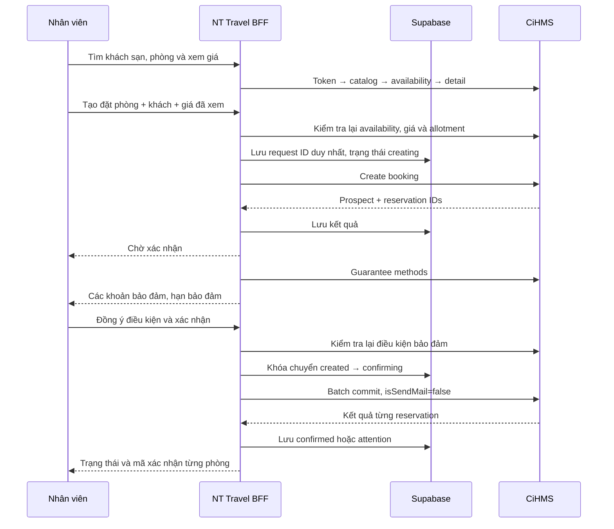

# CiHMS integration — NT Travel

## Overview & Conventions

Nguồn: request/response trong `CiHMS Booking Engine.postman_collection.json` của dự án.
Đây là mô tả implementation hiện tại dựa trên collection, chưa phải bằng chứng đã kiểm thử ghi trên tenant live.
Ngày lưu trú dùng `YYYY-MM-DD`, tiền giữ nguyên currency từ CiHMS. Một reservation ứng với một phòng.
Trình duyệt gọi BFF `/api`; token CiHMS và service key Supabase chỉ có ở server.

## Parameters CiHMS Provides to You

| Cấu hình | Ý nghĩa |
| --- | --- |
| `CLOUDHMS_API_URL` | API base URL của tenant |
| `CLOUDHMS_IDENTITY_URL` | Identity base URL |
| `CLOUDHMS_CLIENT_ID`, `CLOUDHMS_CLIENT_SECRET` | Client credentials |
| `CLOUDHMS_ORGANIZATION_ID` | Organization ID dùng lấy token |
| `CLOUDHMS_ORGANIZATION_CODE` | Organization code trong body API |
| `CLOUDHMS_DISTRIBUTION_CHANNEL_ID` | Channel được phép bán phòng |
| `CLOUDHMS_REQUESTOR_ID` | Requestor ID dùng khi tạo reservation |
| `CLOUDHMS_BOOKING_SOURCE_CODE` | Mã nguồn booking; mặc định `CRO` theo bảng mô tả collection. Xác nhận giá trị tenant; body mẫu dùng `WBS`. |
| `CLOUDHMS_TRAVEL_AGENT_NAME` | Tên profile TravelAgent gắn vào reservation; mặc định `NT_TRAVEL` |
| `CLOUDHMS_TRAVEL_AGENT_PROFILE_ID` | profileRefID của NT_TRAVEL do CiHMS cấp; mặc định `5ad529d3-6b9e-4f3c-8aab-0eed61331aac`. Để trống thì CiHMS chỉ lưu tên, không liên kết profile |

Không dùng identifier mẫu trong collection làm cấu hình live. Allotment, room type và rate plan
được lấy từ availability đúng property/channel. Trình duyệt gửi mã allotment đã chọn; server xác minh lại mã này trong availability của đúng phòng/chương trình trước khi đặt, không tự chuyển sang allotment khác khi hết phòng.

## Integration Flow & API Call Order

## Step 1 — Obtain an Access Token

`POST {identityUrl}/connect/token`, form URL encoded: `grant_type=client_credentials`,
`client_id`, `client_secret`, `organization_id`. Cache token đến trước khi hết hạn 60 giây.
Các request đọc được refresh token một lần khi gặp 401. Request ghi không tự gửi lại.

## Step 2 — Hotel & Room Type Catalog

- `GET /common-trd/v1/pms-property/hotels/info?page=…&limit=…`: đọc đủ trang theo page size thực tế, lọc property active.
- `GET /common-trd/v1/pms-property/room-type?hotelId=…&isPseudo=false`: tên và thông tin hạng phòng.

Catalog được cache 15 phút và đánh chỉ mục tìm kiếm mờ (Fuse.js, extended search) dùng chung cho
`GET /api/properties` (gợi ý) và `POST /api/availability/hotels` (kết quả), nên hai màn hình không
bao giờ lệch tập khớp. Quy tắc so khớp, đặt ra theo đúng dữ liệu thật của CiHMS:

- Bỏ dấu hai phía, và quy `&` về `va` — CiHMS viết liên từ không nhất quán (`Resort và Spa Đà Nẵng`
  nhưng `Resort & Spa Phú Quốc Oasis`).
- Khoảng trắng là AND giữa các token, nên gõ thiếu từ giữa tên vẫn khớp
  (`vinpearl hai phong` → `Vinpearl Hotel Imperia Hải Phòng`).
- Token từ 4 ký tự được sai một ký tự, chịu được lỗi chính tả của chính catalog
  (`vinpearl` → `Vinpear Discovery 1 Phú Quốc`). Token ngắn hơn phải khớp nguyên văn, nếu không
  `hue` trúng cả `phu` và mọi khách sạn Phú Quốc lọt vào kết quả tìm khách sạn Huế.
- Kết quả xếp theo điểm khớp; gợi ý cắt còn 20 dòng đầu.

## Step 3 — Check Availability

- `POST /common-trd/v1/crs/booking/get-hotel-availability`
- `POST /common-trd/v1/crs/booking/get-room-availability`
- `POST /common-trd/v1/crs/booking/get-room-detail-availability`

Occupancy là số khách **mỗi phòng**, không cộng dồn. Không dùng GUID toàn số 0 làm ID.
UI tìm khách sạn và mở từng hạng phòng thành bảng so sánh: allotment là các cột, chương trình giá là các dòng (ghép theo ratePlanId). Mỗi ô giữ giá và tồn phòng của đúng allotment; chương trình không có giá ở allotment nào thì để trống. Mỗi lựa chọn được phân biệt bằng `(roomTypeId, allotmentId, ratePlanId)`, giữ nguyên qua xem chính sách, đổi số khách, lưu nháp và đặt phòng. Availability của một phòng dùng để ghép nhiều hạng cho đoàn. Backend kiểm tra lại đúng allotment, không tính trùng tồn giữa các rate plan, đủ ngày và giá từng phòng trước khi tạo. Phản hồi cũ thiếu allotment giữ luồng xem giá theo phòng/chương trình; không dựng tên allotment giả. Các cột được dựng từ dữ liệu API trả về; phân quyền allotment riêng cho từng tài khoản chưa triển khai.
Detail được lấy cho một phòng; tổng booking là tổng giá từng phòng đã chọn. Giá lẻ theo hạng hiện trước tổng. Thiếu thuế được hiển thị là chưa có dữ liệu.

Trong màn cấu hình, mỗi tab giữ một nhóm khách xuyên suốt kỳ lưu trú. Người dùng có thể đổi mã phòng/dịch vụ và chương trình/allotment cho từng đêm bằng các mã từ availability của đúng ngày đó. Các đêm liền nhau có cùng mã được gộp thành một khoảng để báo giá lại; đổi mã hoặc số khách báo giá lại toàn bộ các khoảng của tab đó. Sức chứa của nhóm là giới hạn thấp nhất trong các mã đã chọn. Bản nháp lưu cả lịch mã phòng và thông tin khách.

Ngày nhận/trả phòng được chỉnh trong thanh bên trái có thể thu gọn và áp dụng chung cho mọi phòng; trên màn hình nhỏ, thanh này nằm phía trên các tab. Thu gọn giữ nguyên ngày đang sửa và hiển thị dấu nhắc nếu chưa áp dụng. Dời ngày giữ thứ tự các mã theo đêm; rút ngắn bỏ các đêm cuối, kéo dài dùng mã của đêm cuối cho các đêm thêm. Chỉ cập nhật ngày và giá sau khi mọi khoảng của mọi phòng được kiểm tra lại availability, sức chứa, tồn chung theo ngày và giá chi tiết; lỗi ở bất kỳ phòng nào giữ nguyên toàn bộ kỳ cũ. Thông tin khách được giữ, đồng ý chính sách phải xác nhận lại; ngày mới cũng được lưu trong bản nháp. Khi còn thay đổi ngày chưa áp dụng, không thể xác nhận hoặc tạo đơn.

## Step 4 — Create & Confirm a Booking

Mỗi khách bắt buộc có họ, tên, quốc gia và quốc tịch. Hai trường `country`/`nationality` được chọn độc lập từ danh sách ISO 3166-1 alpha-2 (249 mã, tên hiển thị tiếng Việt) và gửi dưới dạng mã hai ký tự theo collection CiHMS. Email/SĐT không bắt buộc: có thể bỏ qua hoặc để trống; nếu nhập thì vẫn kiểm tra định dạng. Máy chủ chuẩn hóa liên hệ thiếu/trống về chuỗi rỗng để đối chiếu khách đại diện nhất quán. Khi gửi profile Guest sang CiHMS, chỉ đưa email/SĐT và `primarySearchValues` nếu có dữ liệu liên hệ. Bản nháp cũ giữ họ tên và liên hệ, nhưng không tự đoán quốc gia/quốc tịch; phòng chỉ hoàn tất sau khi bổ sung các trường bắt buộc. Việc gửi country/nationality và bỏ liên hệ trống đã có contract test; luồng tạo đơn không có liên hệ được kiểm chứng trên mock local.

Sau “Xác nhận phòng”, phần thông tin khách hiển thị các tab phòng nằm ngang với số khách đã điền đủ; chữ dùng màu thường khi còn thiếu và chuyển xanh lá khi đã đủ mọi khách trong phòng. Bấm tab mở phần nhập xổ xuống ngay bên dưới, bấm lại để thu gọn hoặc chọn tab khác để chuyển phòng. Chỉ một phòng mở tại một thời điểm; dữ liệu đang nhập vẫn được lưu nháp khi thu gọn, chuyển phòng hoặc tải lại trang. Phần nhập nằm trong trang, không dùng popup, lớp nền tối hay khóa cuộn/điều hướng bàn phím. Form nhập phòng và form tạo booking là hai form riêng; “Lưu và đóng” chỉ thu gọn phòng sau khi kiểm tra dữ liệu, không tạo đơn. Trước khi tạo đơn, giao diện kiểm tra mọi khách kể cả các phòng đang đóng và mở/focus đúng trường đầu tiên còn thiếu, kể cả khi phòng đó đã mở sẵn. Phần cấu hình vẫn ở phía trên để sửa số khách/ngày/mã phòng; chính sách ở phần tổng hợp có thể mở rộng khi cần xem.

1. `POST /api/bookings`: kiểm tra ngày, 1–20 phòng, tối đa 30 đêm, hạng/giá dự kiến từng phòng, đủ thông tin mọi khách, đồng ý chính sách. Một booking chỉ có một property và một khoảng ngày. Giao diện không còn gom các booking khách sạn/ngày khác nhau thành “chặng”. Các trường `journeyId`/`journeyLeg` được giữ ở backend để đọc bản ghi cũ; dịch vụ bổ sung theo ngày trong từng phòng là dữ liệu riêng, không dùng hai trường này. Bản nháp được mở từ “Đặt phòng của tôi”, không hiển thị ở thanh tìm kiếm.
2. Lưu request ID và fingerprint vào `public.bookings` trước lệnh ghi. Live dùng Supabase với quyền BFF;
   cùng request ID chỉ được tạo một lần, kể cả khi các worker nhận request đồng thời.
3. `POST /common-trd/v1/crs/booking`: `distributionChannel` (khác tên trường ở availability),
   `requestorId`, `sourceCode`, `reservations[]` với Booker/TravelAgent/BookingClient (`BookingPortal`)/các Guest trong phòng, totalAmount theo giá từng phòng, roomOccupancy,
   referenceIds và roomRates từng ngày lấy từ dữ liệu server.
   Khi có `roomStaySelections`, mỗi nhóm khách có một danh sách khoảng ngày liên tục, không trùng hoặc thiếu đêm. Backend kiểm tra tổng giá, báo giá lại từng khoảng, kiểm tra tồn phòng và allotment theo từng ngày. Vẫn tạo một reservation cho mỗi nhóm khách; `roomRates[]` mang đúng mã phòng, chương trình và allotment của từng đêm. Thông tin khách không nhân bản thành các nhóm mới khi đổi mã. Các trường hợp có nhiều mã theo ngày đã được kiểm chứng bằng contract test và luồng mock local; chưa tạo đơn live để UAT việc chuyển mã phòng.
4. Đọc `data.reservations[].reservationID`, `confirmationNumber`, `status`. `Prospect` là chờ xác nhận.
5. `POST /common-trd/v1/crs/booking/{id}/guarantee-methods`: hiển thị toàn bộ khoản theo ngày,
   tổng bảo đảm và hạn. Collection lặp cùng ID qua nhiều ngày; batch commit gửi các ID duy nhất.
6. `POST /api/bookings/{id}/confirm` sau khi nhân viên đồng ý. BFF tải lại điều kiện, so hash với
   phiên bản nhân viên đã đọc và khóa trạng thái trước `POST /common-trd/v1/crs/booking/batch-commit`.
   Body dùng `guaranteeInfos`: mỗi method ID duy nhất là `guaranteePolicyId`, `detail.id` là `guaranteeRefID`, không gửi
   `guaranteeValue`. CiHMS ghi `paymentStatus=No`, `settledAmount=0`. Không dùng `guaranteeMethods`: CiHMS ghi
   `Complete`/`Credit` như đã thu tiền (kiểm chứng trên tenant test 2026-09-17).
7. Chỉ báo confirmed khi tất cả `data.items[].reservation` đúng ID, không có errorMessages và đều `Reserved`.
   `isSendMail=false`; xác nhận booking không được diễn giải là đã thu tiền.

## Step 5 — Update / Cancel / Search

Đã triển khai `GET /api/bookings` và `GET /api/bookings/{id}` để xem lại trạng thái lưu tại NT Travel,
giới hạn theo nhân viên đăng nhập. Danh sách là 100 yêu cầu gần nhất; tìm mã, khách sạn và tên khách trên danh sách đó. `GET /api/journeys/:id/bookings` và unique index `(actor_id, journeyId, journeyLeg)` vẫn tương thích với dữ liệu cũ; giao diện hiện không gọi hoặc hiển thị luồng này.
Đây là trạng thái lần cuối NT Travel nhận được; không tự đồng bộ thay đổi ngoài ứng dụng.

Collection có các API dưới đây, **chưa triển khai trong giao diện/backend**:

- `PUT /common-trd/v1/crs/booking/{reservationId}` — cập nhật.
- `POST /common-trd/v1/crs/booking/{reservationId}/cancel-methods` rồi `/cancel` — xem phí trước khi hủy.
- `POST /common-trd/v1/crs/reservation/search-free-text`, `/search`, `/search-reservations` — tìm reservation trên CiHMS.

Không tự hủy Prospect khi người dùng rời màn hình. Đơn `attention` hoặc kẹt `creating`/`confirming`
cần vận hành đối soát với CiHMS bằng `NT-{requestId}` và reservation IDs trước khi thao tác tiếp.

## Step 6 — Error Codes & Handling

Các mã dưới đây là hợp đồng **BFF NT Travel**, không phải bảng mã lỗi chính thức đầy đủ của CiHMS.

| Mã | Xử lý |
| --- | --- |
| `VALIDATION_ERROR` | Sửa ngày, khách hoặc dữ liệu bắt buộc; không gọi create |
| `AUTH_REQUIRED`, `FORBIDDEN`, `PASSWORD_CHANGE_REQUIRED` | Kiểm tra phiên đăng nhập/quyền/mật khẩu tạm |
| `PROPERTY_NOT_FOUND` | Không có khách sạn nào khớp tên đã gõ — sửa **tên**, không sửa ngày; chưa gọi availability nên không có gì để retry |
| `NO_AVAILABILITY` | Khớp tên nhưng hết phòng cho khoảng ngày đã chọn — sửa **ngày**; `details.properties` (tối đa 20) là các khách sạn đã khớp tên. Ở bước rate: tìm lại phòng, không lấy rate đầu tiên thay cho rate đã chọn |
| `PRICE_CHANGED` | Dừng tạo, xem lại giá mới |
| `GUARANTEE_CHANGED` | Tải lại điều kiện và đồng ý lại |
| `BOOKING_CONFLICT` | Mở lại đơn theo ID; không gửi lại với dữ liệu khác |
| `BOOKING_REJECTED` | CiHMS báo business failure; không diễn giải HTTP 200 là thành công |
| `UPSTREAM_RATE_LIMITED`, `UPSTREAM_UNAVAILABLE` | Đọc có thể retry giới hạn; ghi không tự retry |

Khi create/commit timeout, lỗi mạng, batch thiếu kết quả hoặc phản hồi sai hợp đồng sau lệnh ghi,
lưu `attention` thay vì tạo lại. Nếu không lưu được kết quả thì hàng `creating`/`confirming` vẫn chặn phát lại.
Trình duyệt dùng GET để kiểm tra lại trạng thái. Log không chứa khách, token, body hoặc secret.
